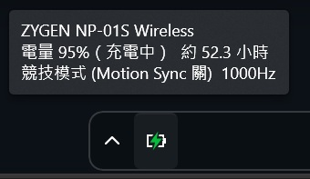
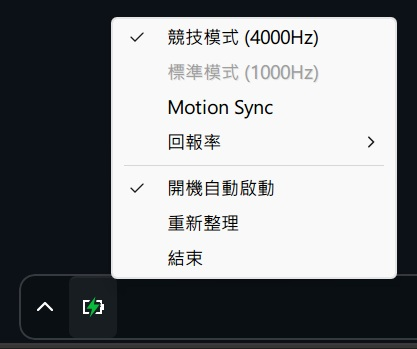

# MousePulse

[English](README.md) | 繁體中文

**非官方的 VAXEE 滑鼠電量工具。**一個給 VAXEE 無線滑鼠用的 Windows 系統匣小工具：隨時看到電量和剩餘使用時間，
一鍵切換競技模式與標準模式。

它直接透過 HID 和滑鼠溝通，使用的協定和官方網頁驅動
[VAXEE Control Center](https://vcc.vaxee.co/) 相同，所以不必為了看電量特地打開瀏覽器。

> **非官方工具。**本專案與 VAXEE 無關，也未經其認可。
> 文中提到的產品名稱僅用於說明相容的硬體。

<p align="center">
  
  
</p>

## 功能

- **系統匣電池圖示**：填滿比例和顏色隨電量變化（綠色 ≥ 50%、橘色 20–49%、紅色 < 20%）。
  充電時改顯示閃電；灰色空電池表示找不到滑鼠。外框顏色會跟著工作列的深色或淺色主題切換。
- **提示文字**：顯示型號、電量、剩餘時間、目前模式和回報率。電量標籤和剩餘時間直接照搬
  VAXEE Control Center 的資料，所以兩邊顯示一致，例如 `50%-70%`、`27.5-37 小時`。
- **右鍵選單**
  - 競技模式（透過接收器時，同時設成 4000Hz）
  - 標準模式（同時設成 1000Hz）
  - Motion Sync 開關，切換時維持目前的模式
  - 回報率子選單：目前模式不支援的回報率會反灰
  - 開機自動啟動
  - 重新整理／結束
- **低電量通知**：電量降到 10% 時通知一次，門檻和官方驅動顯示「請立即充電」的條件相同。
- 透過接收器或充電線連接都可以使用。兩者同時接上時會使用充電線連接，因為這時接收器和滑鼠的連線已經中斷。
- 介面提供英文、繁體中文和簡體中文，自動跟隨 Windows 的顯示語言。
- 約 330 KB 的單一執行檔，不需要安裝，也不需要任何執行環境。同時只會執行一份。

## 系統需求

- Windows 10 或 11（x64）
- 支援的滑鼠（見下方列表），透過接收器或 USB 線連接

## 下載

從 [Releases 頁面](https://github.com/ToooAir/mousepulse/releases/latest)下載最新版本：

- `mousepulse.exe`：系統匣程式，一般使用只需要這個檔案。
- `mousepulse-cli.exe`：選用的除錯工具。
- `SHA256SUMS.txt`：兩個檔案的雜湊值。

每個版本都由 [GitHub Actions](https://github.com/ToooAir/mousepulse/actions) 從對應版本的
原始碼自動編譯，可以清楚看到每個 exe 是怎麼產生的。

### 驗證下載的檔案（選用）

在 PowerShell 執行下面的指令，再和 `SHA256SUMS.txt` 裡對應的那一行比對（不分大小寫）：

```powershell
Get-FileHash .\mousepulse.exe -Algorithm SHA256
```

### 「Windows 已保護您的電腦」

這個 exe 沒有程式碼簽章，第一次執行時可能會被 Microsoft Defender SmartScreen 擋下。
點選 **其他資訊**，再點 **仍要執行** 即可，Windows 之後會記住這個檔案。

如果不想執行未簽章的程式，也可以[自行編譯](#編譯)。

## 使用方式

1. 把 `mousepulse.exe` 放到固定的位置，例如 `C:\Tools\`。
   開啟「開機自動啟動」時會記住這個路徑，所以不建議放在「下載」資料夾。
2. 執行後，電池圖示會出現在通知區域；如果沒看到，點工作列的 `^` 展開隱藏的圖示。
3. 滑鼠移到圖示上看詳細資訊，右鍵開啟選單，左鍵立即重新整理。
   不做任何操作時，每 60 秒會自動更新一次。

使用本工具時請關閉 VAXEE Control Center，兩邊同時送出指令可能會互相干擾。

### 模式和回報率的限制

本工具套用和 VAXEE Control Center 相同的限制：

| 連線方式／滑鼠          | 標準模式    | 競技模式    |
|-------------------------|-------------|-------------|
| 充電線（所有型號）      | 不支援      | 最高 1000Hz |
| 接收器，3395 / 3950 滑鼠 | 最高 1000Hz | 最高 4000Hz |
| 接收器，3954 滑鼠        | 最高 4000Hz | 最高 8000Hz |

滑鼠韌體本身不會擋下超出範圍的設定（例如標準模式搭配 4000Hz），
所以本工具在切換到標準模式之前，會先自動降低回報率。

## 支援的裝置

| 型號                             | 滑鼠 PID   | 感應器 | 狀態 |
|----------------------------------|------------|--------|------|
| NP-01S                           | 1004       | 3395   | 已實測（接收器 2001 與充電線） |
| XE / AX / NP-01                  | 1003、1005、1006 | 3395 | 協定與上面相同，未實測 |
| XE-S / XE-S-L / Sora / E1 / XE V2 / NP-01S V2 / NP-01S Ergo | 1007–1013 | 3950 | 未實測 |
| NP-01S V3 / NP-01 Ergo           | 1014、1015 | 3954   | 依官方驅動程式碼實作，未實測 |

接收器：1001、1002、2001（4K/8K）、2002（8K）。如果你的滑鼠可以使用（或不能使用），
歡迎開 issue 並附上 `mousepulse-cli probe` 的輸出。

## 命令列工具

`mousepulse-cli.exe` 是除錯用的工具，會印出每個送出和收到的封包。

```
mousepulse-cli                 讀取 PID、韌體、電量、模式、回報率
mousepulse-cli list            列出所有 VID 0x3057 的 HID 介面
mousepulse-cli probe           讀取每個 VAXEE 裝置（接收器和充電線）的狀態
mousepulse-cli mode <1-4>      1=競技/MS 關  2=標準/MS 關
                               3=競技/MS 開  4=標準/MS 開
mousepulse-cli rate <1-5>      1=500Hz 2=1000Hz 3=2000Hz 4=4000Hz 5=8000Hz（3954）
mousepulse-cli raw <cmd> <rw> <len> [data..]   送出任意指令（hex），例如 raw 0B 01 01
```

`mousepulse.exe` 另外有兩個測試用參數：

- `--test-low-battery`：啟動時立刻跳出低電量通知，用來確認 Windows 的通知設定是否正常。
- `--lang=en`、`--lang=zh-hant` 或 `--lang=zh-hans`：強制使用指定的介面語言。

## 編譯

編譯目標是 `x86_64-pc-windows-gnu`，可以從 macOS 或 Linux 交叉編譯。

```sh
rustup target add x86_64-pc-windows-gnu
brew install mingw-w64            # 或：apt install mingw-w64
cargo build --release --target x86_64-pc-windows-gnu
# -> target/x86_64-pc-windows-gnu/release/mousepulse.exe、mousepulse-cli.exe
```

`build.rs` 會用 mingw-w64 的 `windres` 把應用程式圖示和版本資訊編進 exe。
使用其他 Windows 編譯目標（MSVC）時仍可正常編譯，但會出現警告，exe 也不會有圖示。

唯一的依賴套件是 [`windows-sys`](https://crates.io/crates/windows-sys)，
其餘全部直接呼叫 Win32 API（`hid.dll`、`setupapi`、`Shell_NotifyIconW`）。

### 測試

協定相關函式、電量表格和圖示繪製都和平台無關，所以測試可以在任何系統上執行：

```sh
cargo test --lib
```

## 運作原理

滑鼠提供一個廠商自訂的 HID 介面（VID `0x3057`、usage page `0xFF05`）。
指令是 ID 為 `0x0E`、長度 64 bytes 的 feature report：

```
送出：0E A5 <cmd> <rw: 01 讀 / 02 寫> <len> <data...>
回應：0E A5 <cmd> <01 資料 / 03 確認> <len> <data...>   （資料從 byte 5 開始）
```

| cmd  | 意義 |
|------|------|
| 0x01 | 韌體版本 |
| 0x07 | 回報率（1=500 … 4=4000、5=8000） |
| 0x08 | 模式：1 byte 的 `1..4`（競技/標準 × Motion Sync）；3954 改用 2 bytes `[mode, motionSync]` |
| 0x0A | 滑鼠 PID（僅限接收器） |
| 0x0B | 電量，以 5% 為一格（0–20 格） |
| 0x0F | 無線連線狀態 |
| 0x10 | 充電狀態（透過充電線連接時也能讀取） |

寫入指令有時要超過 100ms 才會回應確認，所以本工具會重複讀取回應，而不是重新送出指令。

## 專案結構

```
src/lib.rs           協定、裝置存取（Win32 相關部分放在 cfg(windows) 內）
src/bat_table.rs     電量標籤和剩餘時間，由官方驅動的資料產生
src/icon.rs          系統匣電池圖示的繪製
src/main.rs          系統匣程式（mousepulse.exe）
src/bin/mousepulse-cli.rs 除錯用命令列工具（mousepulse-cli.exe）
build.rs             把 assets/app.ico 和版本資訊編進 exe
tools/gen_bat_table.py  從 bat_paramter.js 重新產生 src/bat_table.rs
tools/gen_icon.py       重新產生 assets/app.ico
```

VAXEE Control Center 更新電量表格後，請在瀏覽器開啟並儲存
`https://vcc.vaxee.co/assets/js/vcc-mouse/paramter/bat_paramter.js`，再執行：

```sh
python3 tools/gen_bat_table.py path/to/bat_paramter.js > src/bat_table.rs
cargo fmt
```

## 限制

- 剩餘時間來自 VAXEE 官方的表格，不是依你的實際使用情況計算。
  電量低於 70% 時顯示的是區間，因為電量讀數本身就不夠精確。
- 系統匣程式在 UI 執行緒上讀取滑鼠，重新整理時選單可能會停頓約半秒。
- 插上或拔掉充電線後，要到下一次重新整理才會反映（最多 60 秒，或左鍵點一下圖示）。
- 使用者模式（3954 接收器）、DPI、按鍵反應速度和按鍵自訂都沒有提供，
  請使用 VAXEE Control Center 設定。

## 授權

[MIT](LICENSE)
